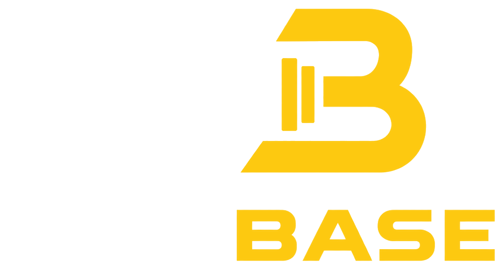
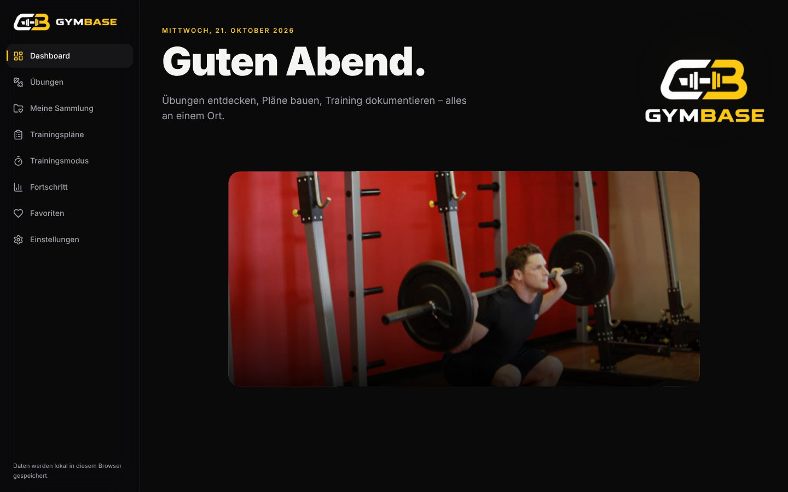
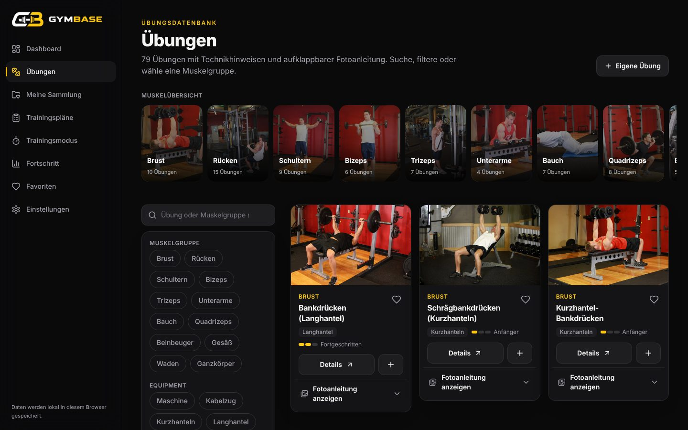
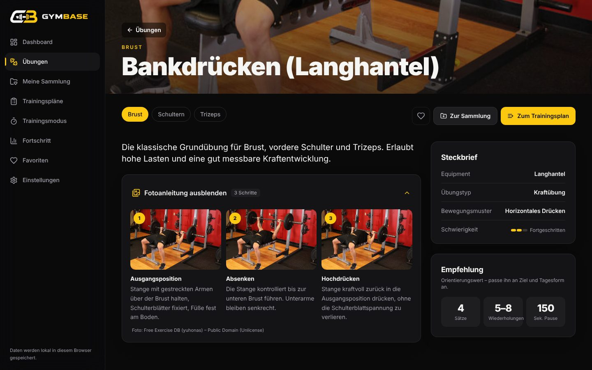
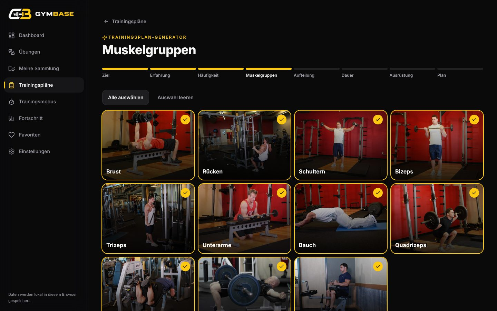
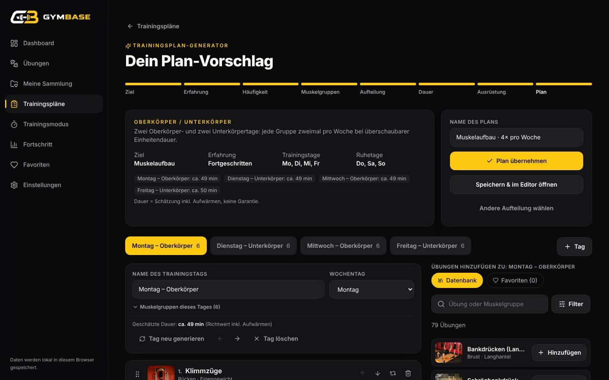
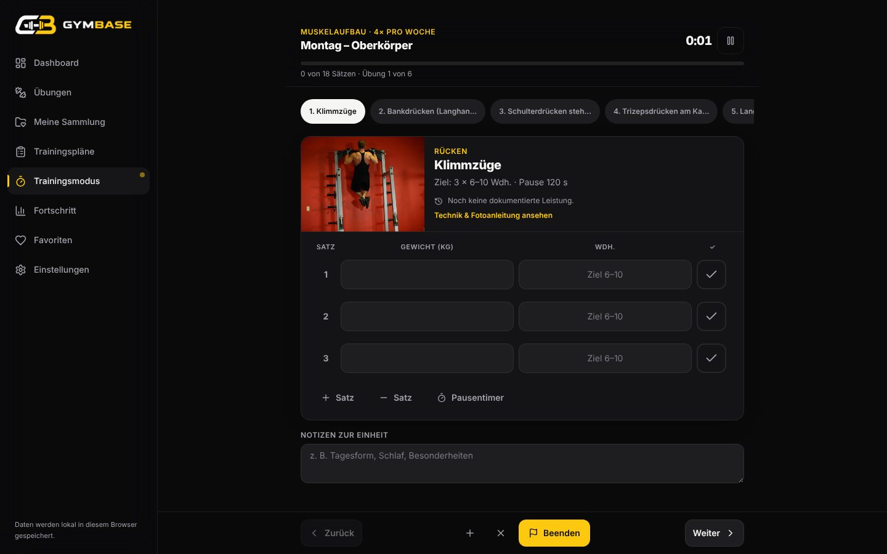
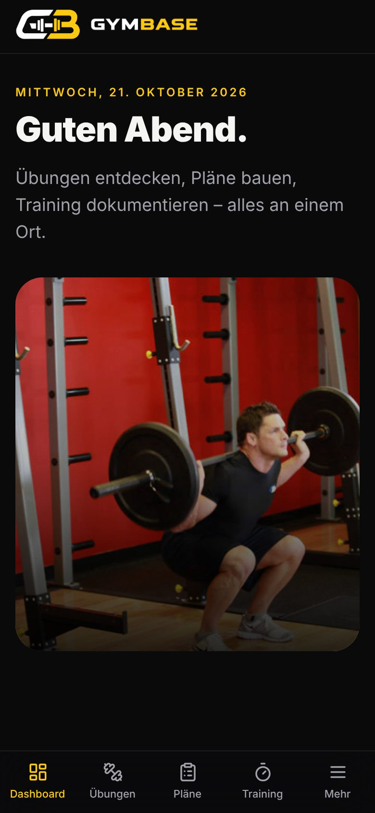
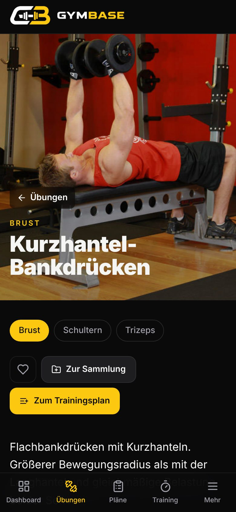

<p align="center">
  
</p>

<p align="center">
  <strong>Übungen entdecken · Pläne bauen · Training dokumentieren · Fortschritt sehen</strong><br>
  Fitness- und Trainingsplattform als lokale Web-App – ohne Login, ohne Backend, Daten bleiben im Browser.
</p>

<p align="center">
  
  
  
  
  
</p>



## Inhalt

- [Funktionen](#funktionen)
- [Schnellstart](#schnellstart)
- [Screenshots](#screenshots)
- [Dokumentation](#dokumentation)
- [Technik](#technik)
- [Projektstruktur](#projektstruktur)
- [Bildquellen & Hinweise](#bildquellen--hinweise)

## Funktionen

| Bereich | Was es kann |
|---|---|
| **Dashboard** | Begrüßung, nächster Trainingstag, Wochenübersicht, Volumen pro Woche, letzte Einheiten, Bestleistungen, Favoriten, Schnellzugriff auf Muskelgruppen |
| **Übungsdatenbank** | 79 Übungen für 12 Muskelgruppen und 8 Geräteklassen, Suche während der Eingabe, kombinierbare Filter (Muskel, Equipment, Schwierigkeit, Typ), Muskelübersicht |
| **Fotoanleitung** | Auf jeder Karte und Detailseite – standardmäßig geschlossen, öffnet animiert, lädt Bilder erst beim Öffnen, Großansicht per Klick |
| **Übungsdetails** | Beschreibung, Ausführung, Technikhinweise, häufige Fehler, Sicherheitshinweise, empfohlene Sätze/Wdh./Pausen, letzte Leistung, Alternativen-Finder |
| **Meine Sammlung** | Eigene Sammlungen (z. B. „Alternativen für belegte Geräte“), eigene Übungen mit eigenen Fotos |
| **Plan-Editor** | Trainingstage anlegen/benennen/sortieren, Übungen aus Datenbank, Favoriten oder Sammlungen, Drag-and-drop und Auf/Ab-Buttons, Sätze, Wiederholungen, Pausen, Zielgewicht, Notizen, Duplizieren |
| **Plan-Generator** | 8 Schritte (Ziel, Erfahrung, Häufigkeit + Wochentage, Muskelgruppen, Aufteilung, Dauer, Ausrüstung, Ergebnis), automatischer oder manueller Split, deterministisch, einzelne Tage neu generieren |
| **Trainingsmodus** | Gewicht und Wiederholungen eintragen, Sätze abhaken, Pausentimer, Training pausieren, letzte Leistung, übersteht ein Neuladen, erkennt neue Bestleistungen |
| **Fortschritt** | Gewichtsentwicklung inkl. geschätztem 1RM, Volumen und Einheiten pro Woche, Bestleistungen, Historie – alles aus gespeicherten Einheiten |
| **Einstellungen** | Dunkel/Hell, Akzent Logo-Gelb/Limegrün, kg/lb, Standardwerte, bevorzugtes Equipment, JSON-Export/-Import, Zurücksetzen |

Dazu: Scroll-Animationen (Zoom, Fade, Parallax, fixierte Sektionen, wortweise Überschriften), animiertes Logo, responsive Layout mit mobiler Navigation, Tastaturbedienung und Unterstützung für „Bewegung reduzieren“.

## Schnellstart

Voraussetzung: [Node.js](https://nodejs.org) ab Version 18.

### Windows – per Doppelklick

`GymBase starten.bat` im Projektordner ausführen. Die Datei installiert beim ersten Mal die Abhängigkeiten, baut die App und öffnet **http://localhost:4173**.

> Der Pfad in der Batch-Datei ist auf `C:\Users\marce\Desktop\gymbase` gesetzt. Bei einem anderen Speicherort die Zeile `cd /d "…"` anpassen.

### Manuell

```bash
npm install
npm run build
npm run preview      # → http://localhost:4173
```

Für die Entwicklung mit Live-Reload: `npm run dev` (→ http://localhost:5173).

> **Wichtig:** Daten werden pro Adresse gespeichert. `localhost:4173` und `localhost:5173` haben getrennte Daten. Zum Umziehen: *Einstellungen → Daten exportieren / importieren*.

Alle Details: [docs/ANLEITUNG.md](docs/ANLEITUNG.md)

## Screenshots

| Übungsdatenbank | Fotoanleitung |
|---|---|
|  |  |
| **Generator – Muskelgruppen** | **Generator – Ergebnis** |
|  |  |
| **Trainingsmodus** | **Mobil** |
|  |   |

## Dokumentation

| Dokument | Inhalt |
|---|---|
| [Anleitung](docs/ANLEITUNG.md) | Installation, Starten, Bedienung aller Bereiche, Datensicherung, Problemlösung |
| [Architektur](docs/ARCHITEKTUR.md) | Aufbau, Datenfluss, Animationssystem, Designentscheidungen |
| [Datenmodell & Speicherung](docs/DATEN.md) | Typen, localStorage/IndexedDB, Versionierung, Export-Format |
| [Generator](docs/GENERATOR.md) | Regeln des Trainingsplan-Generators im Detail |
| [Entwicklung](docs/ENTWICKLUNG.md) | Befehle, Tests, Codekonventionen, eigene Übungen ergänzen |
| [Changelog](CHANGELOG.md) | Versionshistorie |

## Technik

React 18 · TypeScript 5 · Vite 5 · Tailwind CSS 3 · GSAP 3 + ScrollTrigger · Chart.js 4 (react-chartjs-2) · dnd-kit · React Router 6 (HashRouter) · Lucide Icons · Vitest · ESLint 9

## Projektstruktur

```
gymbase/
├─ public/
│  ├─ brand/              Logo (in animierbare Ebenen zerlegt) + Favicon
│  └─ exercises/<id>/     Übungsfotos (0.jpg, 1.jpg)
├─ src/
│  ├─ animations/         ScrollReveal, ScrollZoom, PinnedSection, ParallaxSection, SplitHeadline, useGsap
│  ├─ components/         Layout, Logo, ExerciseCard, PhotoGuide, PlanDaysEditor, Charts, UI-Bausteine
│  ├─ data/               Übungsdatenbank, Beschriftungen
│  ├─ pages/              Dashboard, Übungen, Detail, Sammlung, Pläne, Editor, Generator, Training, Fortschritt, Favoriten, Einstellungen
│  ├─ services/           Speicherung, Bilder (IndexedDB), Generator, Statistik, Suche, Import/Export, Zeitplan
│  ├─ store/              App-Store, Toasts, Bestätigungsdialoge
│  ├─ styles/             Tailwind + Design-Tokens
│  ├─ types/              Datenmodell
│  └─ utils/              Hilfsfunktionen
├─ tests/                 Unit-Tests (Vitest)
├─ e2e/                   Browser-Smoke-Test (Playwright, optional)
├─ docs/                  Dokumentation + Screenshots
└─ GymBase starten.bat    Start per Doppelklick (Windows)
```

## Bildquellen & Hinweise

- Übungsfotos: [Free Exercise DB](https://github.com/yuhonas/free-exercise-db) – Public Domain (Unlicense). Pro Übung zwei Fotos; wo ein Schritt nicht fotografiert ist, zeigt die Anleitung einen gekennzeichneten Platzhalter.
- Logo: eigenes GymBase-Logo.
- GymBase ersetzt keine ärztliche oder trainerische Beratung. Empfehlungen sind Orientierungswerte, Zeitangaben sind Schätzungen.
