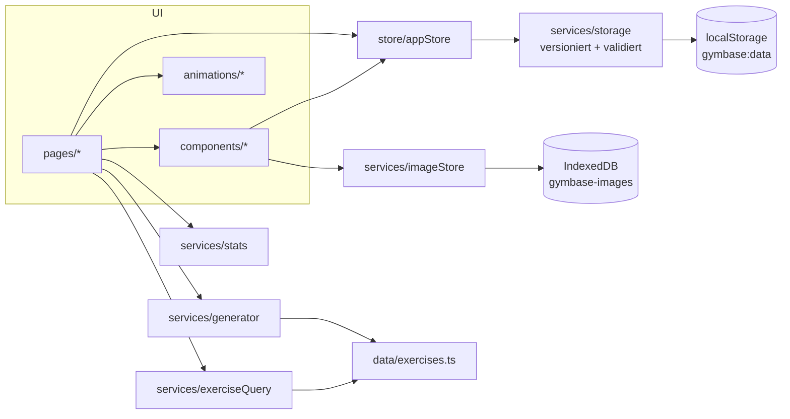

# Architektur

[← Zurück zur README](../README.md)

## Überblick

GymBase ist eine reine Client-Anwendung (Single Page App). Es gibt keinen Server-Code; `npm run preview` liefert nur die statischen Dateien aus `dist/` aus.

## Schichten

| Schicht | Ordner | Verantwortung |
|---|---|---|
| Daten | `src/data` | Statische Übungsdatenbank und Beschriftungen (DE) |
| Typen | `src/types` | Gemeinsames Datenmodell |
| Logik | `src/services` | Reine Funktionen ohne UI: Speicherung, Bilder, Generator, Statistik, Suche/Alternativen, Import/Export, Zeitplan |
| Zustand | `src/store` | Externer Store mit `useSyncExternalStore`; Aktionen wie `savePlan`, `startSession`, `toggleFavorite` |
| Darstellung | `src/components`, `src/pages` | React-Komponenten, Routing über `HashRouter` |
| Animation | `src/animations` | GSAP-Komponenten, sauber auf- und abgebaut |

Die Logik in `services` kennt React nicht und ist dadurch direkt testbar (`tests/`). Ein späteres Backend kann `services/storage.ts` und die Store-Aktionen ersetzen, ohne die Oberfläche anzufassen.

## Store

`store/appStore.ts` hält den kompletten `AppData`-Zustand. Jede Änderung läuft über `setState(updater)`, wird sofort in localStorage geschrieben und benachrichtigt alle Abonnenten. Komponenten lesen gezielt mit `useApp(selector)`.

`store/uiStore.ts` enthält Toasts und einen Promise-basierten Bestätigungsdialog (`await confirmDialog({...})`).

## Routing

| Pfad | Seite |
|---|---|
| `#/` | Dashboard |
| `#/uebungen` (`?muskel=brust`) | Übungsdatenbank |
| `#/uebungen/:id` | Übungsdetail |
| `#/sammlung` (`?neu=1`) | Meine Sammlung |
| `#/plaene` | Planliste |
| `#/plaene/neu`, `#/plaene/:id` | Plan-Editor |
| `#/plaene/generator` | Generator |
| `#/training` (`?plan=<id>`) | Trainingsmodus |
| `#/fortschritt` | Fortschritt |
| `#/favoriten` | Favoriten |
| `#/einstellungen` | Einstellungen |

Seiten werden per `React.lazy` nachgeladen; GSAP, Chart.js und React liegen in eigenen Chunks.

## Animationssystem

Alle Komponenten in `src/animations` bauen auf `useGsap()` auf: GSAP-Code läuft in einem `gsap.context`, der beim Unmount oder bei Änderung der Abhängigkeiten vollständig zurückgesetzt wird (inkl. aller ScrollTrigger). So entstehen keine doppelten Trigger beim Seitenwechsel.

| Komponente | Effekt | Einsatz |
|---|---|---|
| `ScrollReveal` | Gestaffeltes Einblenden (Opacity + Y + optional Scale) per `ScrollTrigger.batch` | Karten, Kennzahlen, Listen |
| `SplitHeadline` | Wortweise Überschrift | Hero, Detailseite, Abschnittsüberschriften |
| `ScrollZoom` | Scrollgekoppelter Bildzoom + Abdunklung | Übungsdetail-Hero |
| `ParallaxSection` | Langsamer Hintergrund | Muskelgruppen-Bereich im Dashboard |
| `PinnedSection` | Bild bleibt stehen, Texte wechseln | „So funktioniert GymBase“ (bei < 3 Einheiten) |
| `AnimatedSection` | Weicher Seitenübergang | Jede Route |
| Dashboard-Hero | Bild skaliert von 78 % auf 100 %, Sektion kurz fixiert | Dashboard |
| `AnimatedLogo` | Logo-Aufbau (C und B fahren zusammen, Schriftzug steigt auf, „Hantel anheben“) | Intro, Dashboard, Abschluss-Bildschirm |

Regeln:
- Nur `transform` und `opacity` werden animiert.
- Unter 768 px Breite: kein Pinning und kein Parallax, schwächerer Zoom.
- `prefers-reduced-motion` **oder** die App-Einstellung „Animationen reduzieren“ schalten die Effekte ab; Inhalte sind dann sofort sichtbar.
- Im Trainingsmodus nur kleine Rückmeldungen (Übungswechsel, Fortschrittsbalken, abgehakter Satz).

## Betrieb / Hosting

| Variante | Wie | Adresse |
|---|---|---|
| Lokal | `GymBase starten.bat` bzw. `npm run preview` | http://localhost:4173 |
| Entwicklung | `npm run dev` | http://localhost:5173 |
| Online | GitHub Pages über `.github/workflows/deploy.yml` | https://marcl11111.github.io/gymbase/ |

Überall wird nur der statische Build (`dist/`) ausgeliefert; Daten bleiben im jeweiligen Browser. Details: [VEROEFFENTLICHEN.md](VEROEFFENTLICHEN.md).

## Logo

`public/brand/` enthält das Originallogo, zerlegt in transparente Ebenen: `mark-c.png` (weißes C), `mark-b.png` (gelbes B), `word-gym.png`, `word-base.png`. Alle Ebenen haben identische Abmessungen und werden übereinander gelegt, damit sie einzeln animiert werden können. Im hellen Modus werden die weißen Ebenen per CSS-Filter dunkel dargestellt.

## Designentscheidungen

| Entscheidung | Begründung |
|---|---|
| Akzentfarbe #FDC910 (Logo-Gelb) statt Limegrün | Einheitlich mit dem Logo; Limegrün in den Einstellungen wählbar |
| HashRouter, `base: './'` | Läuft auf jedem statischen Server ohne Rewrite-Regeln und in Unterordnern |
| Eigener Store statt Redux/Zustand | Wenig Code, keine zusätzliche Abhängigkeit |
| Fotos lokal statt per Hotlink | Unabhängig von externen Servern, schneller |
| Gewichte intern in kg | Einheitenwechsel verfälscht keine gespeicherten Daten |
| Trainingseinheiten als Snapshot | Spätere Planänderungen verändern die Historie nicht |
