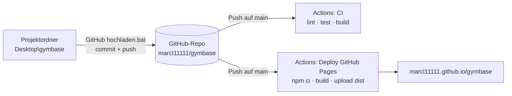

# Veröffentlichen: GitHub & GitHub Pages

[← Zurück zur README](../README.md)

| | Adresse |
|---|---|
| **Live-Version** | <https://marcl11111.github.io/gymbase/> |
| **Repository** | <https://github.com/marcl11111/gymbase> |
| **Profil** | <https://github.com/marcl11111> |

## Überblick

## Änderungen hochladen

Doppelklick auf **`GitHub hochladen.bat`** im Projektordner. Das Skript (`tools/github-hochladen.ps1`):

1. prüft **Git** und **GitHub CLI** und bietet bei Bedarf die Installation per `winget` an,
2. meldet beim ersten Mal per Browser an (inkl. Berechtigung `workflow` für die GitHub-Actions-Dateien),
3. verschiebt neue Workflow-Dateien aus `tools/` nach `.github/workflows/`,
4. committet alle Änderungen („Update vom JJJJ-MM-TT HH:MM“) und pusht nach `main`,
5. setzt Beschreibung, Website-Link und Topics des Repositorys,
6. schaltet **GitHub Pages** (Quelle: GitHub Actions) ein und stößt das Deployment an,
7. aktualisiert den GymBase-Abschnitt im Profil-README (`marcl11111/marcl11111`) – zwischen `<!-- GYMBASE:START -->` und `<!-- GYMBASE:END -->`, ohne den Rest zu verändern,
8. zeigt Repository-, Profil- und Website-URL an und öffnet das Repository.

Mehrfach ausführbar: Ohne Änderungen wird nichts committet; der Profil-Abschnitt wird ersetzt, nicht doppelt eingefügt.

Hat jemand direkt auf GitHub etwas geändert, führt das Skript die Stände zusammen; bei Konflikten haben die **lokalen Dateien Vorrang**.

## Online-Version (GitHub Pages)

- Jeder Push auf `main` startet den Workflow **„Deploy GitHub Pages“** (`.github/workflows/deploy.yml`). Nach ca. 1–2 Minuten ist die neue Version online. Fortschritt: Repository → Reiter **Actions**.
- Gebaut wird mit `npm ci` und `npm run build`; veröffentlicht wird nur der Ordner `dist/`.
- Pages ist mit einem kostenlosen GitHub-Konto nur für **öffentliche** Repositories verfügbar.
- Status und Einstellungen: Repository → **Settings → Pages** („Your site is live at …“, *Source: GitHub Actions*).

Warum es ohne Anpassungen läuft: Vite baut mit `base: './'` (relative Pfade) und die App nutzt `HashRouter` (`#/uebungen` …). Dadurch funktionieren Unterordner wie `/gymbase/` und ein Neuladen auf jeder Unterseite ohne Server-Konfiguration.

## Daten online vs. lokal

Die App speichert alles im Browser – getrennt **pro Adresse**:

| Adresse | Eigener Datenbestand |
|---|---|
| `http://localhost:4173` (Batch-Datei / Preview) | ✔ |
| `http://localhost:5173` (`npm run dev`) | ✔ |
| `https://marcl11111.github.io/gymbase/` | ✔ |
| Handy-Browser | ✔ |

Übertragen: *Einstellungen → Daten exportieren* (Quelle) → *Daten importieren* (Ziel) → „Zusammenführen“ oder „Alles ersetzen“.

Es werden **keine Trainingsdaten auf GitHub** gespeichert – die Online-Version ist nur die App selbst.

## Am Handy als App

`https://marcl11111.github.io/gymbase/` im Handy-Browser öffnen → Browser-Menü → **„Zum Startbildschirm hinzufügen“**. GymBase startet dann wie eine App (Daten bleiben auf dem Handy).

## Problemlösung

| Problem | Ursache | Lösung |
|---|---|---|
| Weiße Seite nach dem Veröffentlichen | Browser zeigt eine alte, zwischengespeicherte Version (GitHub erlaubt bis zu 10 min Cache) | **`Strg + F5`** oder privates Fenster; sonst 10 min warten |
| 404 „There isn't a GitHub Pages site here“ | Deployment läuft noch oder Pages ist aus | Actions abwarten; *Settings → Pages → Source: GitHub Actions* prüfen |
| Roter Lauf in Actions | Build- oder Testfehler | Lauf öffnen, fehlgeschlagenen Schritt lesen; lokal `npm run lint`, `npm test`, `npm run build` |
| Push abgelehnt wegen `workflow` | Anmeldung ohne Workflow-Berechtigung | `gh auth refresh -s workflow` oder Skript erneut starten |
| Neue Version nicht sichtbar | Cache | `Strg + F5` |
| Online fehlen meine Pläne | Daten sind pro Adresse getrennt | Export/Import (siehe oben) |

## Eigene Domain (optional)

1. Beim Domain-Anbieter einen **CNAME**-Eintrag anlegen, z. B. `gymbase` → `marcl11111.github.io`.
2. *Settings → Pages → Custom domain* eintragen (eine `CNAME`-Datei wird bei Veröffentlichung per Actions ignoriert).
3. HTTPS kann bis zu 1 Stunde dauern; bei CAA-Einträgen muss `letsencrypt.org` erlaubt sein.
4. Keine Wildcard-Einträge (`*.domain.de`) verwenden.

Achtung: Eine neue Adresse bedeutet wieder einen eigenen Datenbestand im Browser (Export/Import).
